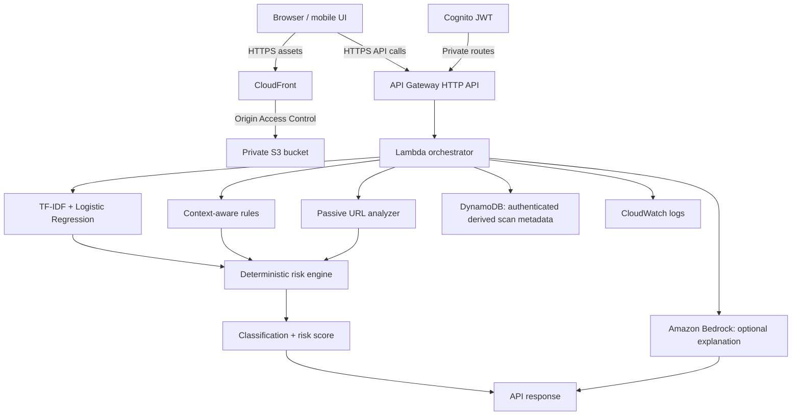

<div align="center">

<h1>🛡️ RuralShield AI</h1>

<p><strong>Privacy-first, explainable phishing-risk detection for rural banking users.</strong></p>

<p>
  
  
  
  
  
  
  
</p>

<p>
  
  
</p>

</div>

---

RuralShield AI is a mobile-first, serverless prototype that helps users assess phishing risk in banking messages and URLs. It combines a lightweight machine-learning model, deterministic social-engineering rules, passive URL analysis, and optional Amazon Bedrock explanations in one explainable workflow. The system is designed to minimize the amount of sensitive information stored.

> **Safety notice:** Never enter a real OTP, PIN, password, or complete card number into RuralShield AI. This is a research and educational prototype, not a certified banking fraud-detection service. Results are probabilistic and should not replace official bank channels or sound judgment.

## Table of Contents

- [What It Does](#what-it-does)
- [Architecture](#architecture)
- [Tech Stack](#tech-stack)
- [Detection Layers](#detection-layers)
- [Risk Decision](#risk-decision)
- [ML Model & Evaluation](#ml-model--evaluation)
- [API Reference](#api-reference)
- [Privacy Model](#privacy-model)
- [Security Controls](#security-controls)
- [Multilingual Support](#multilingual-support)
- [Repository Layout](#repository-layout)
- [Local Development](#local-development)
- [AWS Deployment](#aws-deployment)
- [CI / Quality Gate](#ci--quality-gate)
- [SDG Alignment](#sdg-alignment)
- [What Production Deployment Still Requires](#what-production-deployment-still-requires)
- [License](#license)

## What It Does

`POST /scan` accepts a suspicious banking message or URL and returns the following fields:

| Field | Description |
|---|---|
| `classification` | `SAFE`, `SUSPICIOUS`, or `PHISHING` |
| `risk_score` | Deterministic 0–100 risk score from the security detection path |
| `confidence_level` | Qualitative decision strength (`LOW`, `MEDIUM`, `HIGH`), **not** a calibrated probability |
| `reasons` | Human-readable detection signals |
| `detected_language` | `en`, `hi`, or `ta` |
| `scam_category` | Categorized scam type |
| `recommendation` | Plain-language safety guidance |
| `components` | ML, URL, rules, and AI observability values |
| `model_version` | Version of the ML artifact used for the scan |

**Decision boundary:** Amazon Bedrock does **not** contribute to the final security classification. That decision is based on the ML model, deterministic rules, and passive URL evidence. Bedrock provides contextual explanations and recommendations; it can be disabled or unavailable without preventing the deterministic detection path from producing a verdict.

The interface follows the operating system's light or dark preference by default and provides a manual theme toggle whose choice is saved in the browser. Scan history and statistics require a valid Cognito session. Anonymous scans are not saved to personal history, and feedback is available only when a result was successfully persisted.

## Architecture



**Security boundary:** the risk engine combines the ML score, rule-based signals, and passive URL evidence. Bedrock supplies optional explanations and recommendations; it does not influence the final classification.

The frontend is stored in a private S3 bucket and delivered through CloudFront using Origin Access Control (OAC). The API does not fetch submitted URLs; URL analysis is passive and performed locally by the backend.

## Tech Stack

### AWS

| Service | Role |
|---|---|
| AWS Lambda | Serverless Python backend |
| API Gateway HTTP API | API routing, CORS, throttling |
| DynamoDB | Owner-scoped sanitized scan metadata |
| Amazon Bedrock | Optional contextual explanation using Nova Lite |
| Amazon S3 | Private static frontend storage |
| Amazon CloudFront | HTTPS frontend delivery and CDN |
| Amazon Cognito | Authentication for private user data |
| AWS IAM | Least-privilege service authorization |
| Amazon CloudWatch | Logs and operational visibility |
| AWS SAM / CloudFormation | Infrastructure as Code |

### Backend

- Python 3.12
- Pure-Python TF-IDF + logistic regression inference
- `boto3` / `botocore`
- `pytest`
- `ruff`

### Frontend

- HTML5
- CSS3
- Vanilla JavaScript (ES2020+)
- Fetch API
- Lightweight localization for English, Hindi, and Tamil

## Detection Layers

### 1. Machine Learning

The current detector uses **TF-IDF and Logistic Regression**, with inference designed to avoid heavyweight machine-learning dependencies in Lambda. The repository includes the training pipeline, serialized model artifact, model-version metadata, and evaluation outputs.

### 2. Rule Engine

Explainable social-engineering rules identify signals such as:

- OTP/PIN/password requests
- credential requests
- account threats
- KYC pressure
- urgency
- payment demands
- lottery/reward lures
- fake refunds
- loan scams
- fake support
- bank impersonation

The rules also recognize mitigating security-awareness signals, such as messages reminding users that a bank will never ask them to share an OTP. These signals help reduce obvious false positives.

### 3. Passive URL Analyzer

The analyzer does not open or request submitted URLs. Instead, it checks structural indicators such as:

- IP-address hosts
- `@` URL confusion
- URL/hostname length
- suspicious subdomain depth
- URL shorteners
- encoded characters
- IDN/punycode
- bank-brand impersonation
- typo-like domains
- suspicious keywords
- high-entropy domains

These indicators contribute to a risk assessment; none is conclusive proof that a URL is malicious.

### 4. Amazon Bedrock

Bedrock can use the sanitized message and structured local evidence to generate:

- plain-language summary
- explanation reasons
- scam category
- recommended action

Prompt instructions treat submitted content as untrusted data, and model output is validated before use. Bedrock does not override the deterministic security decision.

## Risk Decision

The risk score is calculated from the available deterministic components:

```text
Risk Score = weighted average of active ML + URL + Rules scores
```

Default weights:

```text
ML       40%
URL      25%
Rules    20%
```

The configured weights total 85% because the remaining 15% is intentionally **excluded from the security decision**; Bedrock is used only for explanations and context. If the ML model or URL analyzer is unavailable, the weights of the active components are renormalized.

Classification thresholds are configurable:

```text
0–30    SAFE
31–65   SUSPICIOUS
66–100  PHISHING
```

`confidence_level` is a qualitative decision-strength indicator. It is not a calibrated probability and should not be interpreted as one.

## ML Model & Evaluation

The repository uses a **40-row synthetic demonstration dataset** for development and reproducible CI runs:

- 20 safe examples
- 20 phishing examples
- 28 training rows
- 6 validation rows
- 6 test rows
- fixed seed: 42

Current held-out evaluation is:

| Metric | Validation | Test |
|---|---:|---:|
| Accuracy | 83.33% | 83.33% |
| Phishing precision | 100% | 100% |
| Phishing recall | 66.67% | 66.67% |
| Phishing F1 | 80.00% | 80.00% |

These results are **not production benchmarks**: the test partition contains only six examples. Meaningful performance claims require evaluation on a larger, license-compatible, deduplicated real-world dataset.

The synthetic dataset is retained so CI can reproduce the model artifact consistently.

## API Reference

### `POST /scan`

Public scan endpoint. Anonymous scans are supported, but their results are not stored as personal history. History persistence requires an authenticated Cognito ID token.

Example request:

```json
{
  "type": "message",
  "text": "URGENT: Your KYC expires today. Verify at http://example.invalid to avoid account block.",
  "language": "en"
}
```

The response includes the classification, risk score, qualitative confidence level, reasons, detected language, scam category, model version, component scores, URL-analysis details, and Bedrock availability.

### `GET /history`

Authenticated endpoint. Returns only records belonging to the authenticated Cognito user.

### `GET /statistics`

Authenticated endpoint. Returns statistics computed from that user's stored scan records.

### `POST /feedback`

Authenticated endpoint. Records whether a stored result was helpful or incorrect after verifying ownership.

### `GET /health`

Public liveness endpoint.

## Privacy Model

RuralShield is designed to limit the persistence of sensitive content:

- raw message bodies are not stored
- only derived scan metadata is persisted
- recognizable OTP, card, password, and account-related patterns are redacted before downstream AI processing or persistence where practical
- anonymous scans are not persisted as user history
- authenticated records are owner-scoped by Cognito user ID
- CloudWatch logging excludes raw message content and secrets

Never enter real banking credentials into the application.

## Security Controls

Implemented security controls include:

- strict request validation and bounded input size
- private S3 bucket with Public Access Block
- CloudFront Origin Access Control
- HTTPS-only CloudFront delivery
- exact-origin CORS configuration
- API throttling
- least-privilege Lambda IAM policies
- DynamoDB server-side encryption and PITR
- passive URL analysis with no server-side URL fetching
- prompt-injection-aware Bedrock system instructions
- defensive Bedrock response validation and failure fallback
- Cognito JWT authentication for private endpoints
- server-side ownership enforcement
- defensive HTTP headers
- secret-leak checks in GitHub Actions
- CloudWatch log retention

See [`docs/security.md`](docs/security.md) for the threat model and residual risks.

## Multilingual Support

The interface supports:

- English
- Hindi (हिन्दी)
- Tamil (தமிழ்)

Multilingual support currently applies primarily to the user interface. The bundled ML dataset is primarily English and is not sufficient to support claims of production-quality phishing detection in Hindi, Tamil, or mixed-language messages.

## Repository Layout

```text
ruralshield/
├── backend/
│   └── lambda/
│       ├── handler.py
│       ├── validators.py
│       ├── sanitizer.py
│       ├── language.py
│       ├── ml_predictor.py
│       ├── model.json
│       ├── rules.py
│       ├── url_analyzer.py
│       ├── bedrock_service.py
│       ├── risk_engine.py
│       ├── storage.py
│       └── config.py
│
├── frontend/
│   ├── index.html
│   ├── app.js
│   ├── auth.js
│   ├── styles.css
│   └── runtime-config.js
│
├── infrastructure/
│   └── template.yaml
│
├── ml/
│   ├── train.py
│   ├── evaluate_hybrid.py
│   ├── evaluation.json
│   ├── hybrid_evaluation.json
│   └── data/
│       └── demo_dataset.csv
│
├── tests/
│   ├── test_core.py
│   ├── test_edge_cases.py
│   ├── test_frontend_contract.py
│   ├── test_integrations.py
│   ├── test_privacy_boundaries.py
│   ├── test_risk_availability.py
│   ├── test_security.py
│   ├── test_url_analyzer_edge_cases.py
│   └── test_url_intelligence.py
│
├── scripts/
│   ├── deploy.sh
│   ├── deploy.ps1
│   ├── setup.sh
│   └── setup.ps1
│
├── docs/
│   ├── api.md
│   ├── architecture.md
│   ├── architecture-decisions.md
│   ├── model-card.md
│   └── security.md
│
├── .github/
│   └── workflows/
│       └── ci.yml
│
├── .gitignore
└── README.md
```

## Local Development

### Prerequisites

- Python 3.12+
- Node.js
- AWS SAM CLI for infrastructure validation/build

### Setup

```bash
python -m venv .venv

# Windows
.venv\\Scripts\\activate

# Linux/macOS
source .venv/bin/activate

pip install -r backend/requirements.txt pytest ruff
```

### Train / evaluate

```bash
python ml/train.py
python ml/evaluate_hybrid.py
```

### Test

```bash
pytest -q
```

### Lint

```bash
ruff check backend/lambda ml tests
```

### Local frontend

```bash
python -m http.server 8080 -d frontend
```

## AWS Deployment

### Requirements

- AWS CLI authenticated with appropriate permissions
- AWS SAM CLI
- Amazon Bedrock access to the configured model in the target region

Default region:

```text
ap-south-1
```

Default Bedrock model:

```text
amazon.nova-lite-v1:0
```

### Deploy on Windows

```powershell
.\\scripts\\deploy.ps1 -StackName ruralshield-ai
```

### Deploy on Linux/macOS

```bash
./scripts/deploy.sh ruralshield-ai
```

The deployment scripts build the SAM application, provision AWS resources, configure the exact frontend origin for CORS, inject runtime API/Cognito configuration, upload the static frontend to the private S3 bucket, and invalidate CloudFront.

> CI validation is not a live AWS smoke test. A deployment should only be called verified after running it in an authorized AWS account and testing `/health`, `/scan`, authentication, history, statistics, and feedback.

## CI / Quality Gate

GitHub Actions verifies:

- committed-secret patterns
- Ruff linting
- ML training/artifact reproducibility
- hybrid evaluation reproducibility
- pytest regression suite
- Python compilation
- frontend asset and JavaScript syntax checks
- frontend element-binding contract tests and passive URL edge-case regression tests
- SAM template validation
- SAM build
- Lambda package contents

The automated test suite covers core detection, edge cases, integrations, privacy boundaries, component availability, frontend contracts, and URL-analysis behavior.

## SDG Alignment

| Goal | Connection |
|---|---|
| **SDG 9 — Industry, Innovation and Infrastructure** | Uses AI/ML, serverless cloud infrastructure, and secure digital services to improve phishing-risk protection for rural banking. |
| **SDG 10 — Reduced Inequalities** | Focuses on improving digital-safety access for rural and underserved banking users who may face greater digital-literacy barriers. |

## What Production Deployment Still Requires

The following work remains before the project could be considered for production use:

1. A larger, license-compatible, deduplicated real-world phishing corpus.
2. Frozen train/validation/test partitions with leakage controls and stronger statistical evaluation.
3. Probability calibration if numeric confidence is presented.
4. Per-language and code-switched evaluation for Hindi/Tamil/Hinglish/Tanglish.
5. Optional reputation-based URL intelligence with strict privacy/timeouts.
6. Live AWS smoke testing, latency measurement, rollback testing, and cost monitoring.
7. WAF/advanced abuse protection, CloudWatch alarms, SLOs, and operational runbooks for a public deployment.
8. Broader usability/accessibility validation with the intended rural audience.

Synthetic data and unverified metrics are not substitutes for this validation.

## License

This project is licensed under the MIT License. See [LICENSE](LICENSE).

<div align="center">

**Built for rural banking security with AWS, AI/ML, and privacy by design.**

</div>
